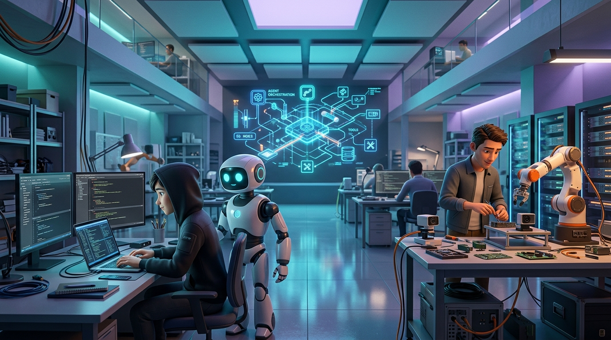
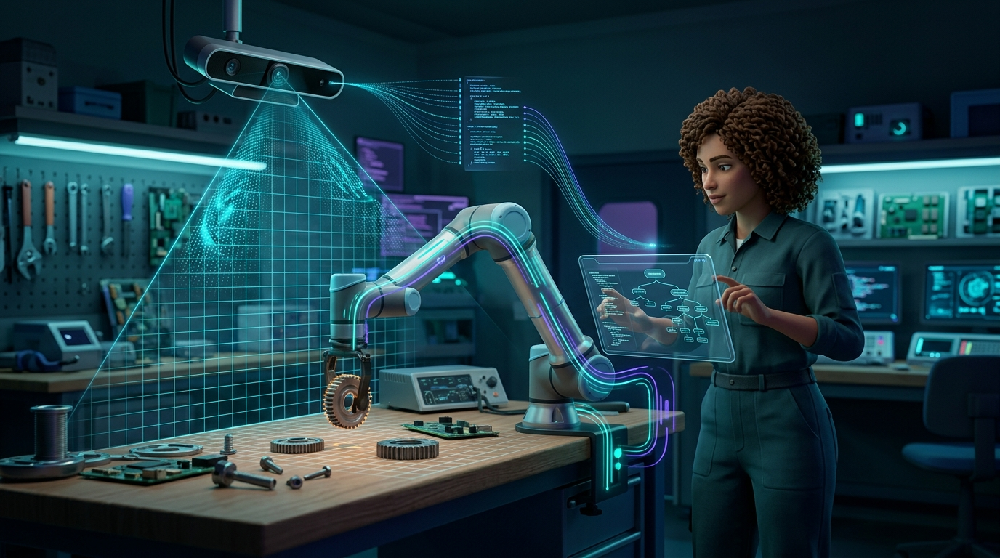
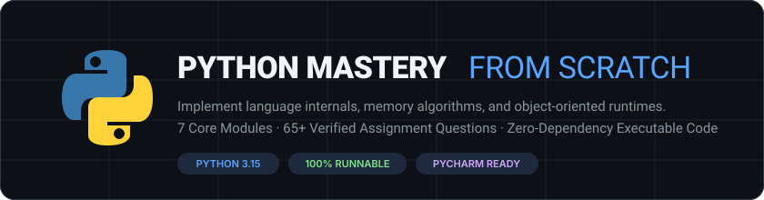

<div align="center">
  
  <br><br>

# Hi there, I'm Vinayak Sharma 👋
### AI/ML Research Engineer • Physical AI & Robotics Builder • Systems Architect

[](https://vinayaksharmadev.vercel.app/)
[](https://github.com/vsbeginner)
[](https://www.linkedin.com/in/vinayak-sharma-24a8aa384/)
[](mailto:vsbeginner14@gmail.com)
[](https://github.com/vsbeginner)

<p align="center">
  
</p>

</div>

---

## 👨‍💻 Executive Profile

I am an **AI/ML Research Engineer and Robotics Builder** pursuing a **Master of Computer Applications (MCA) with specialization in AI & Machine Learning** at **K.R. Mangalam University**, and a Core Contributor at **EDEMS Pvt. Ltd.**

My engineering work bridges the gap between theoretical deep learning foundations and real-world physical and digital systems:
- **Generative AI & Probabilistic Modeling**: Evidence Lower Bound (ELBO) optimization in VAEs, adversarial game-theoretic minimax convergence in GANs, parameter-efficient fine-tuning (PEFT) on causal language models (GPT-2), and multimodal latent diffusion pipelines (Stable Diffusion v1.5).
- **Computer Vision & Physical Robotics**: Real-time object detection (YOLOv8, OpenCV), 2D Cartesian inverse kinematics, multi-axis motor actuation, and embedded microcontroller firmware (Arduino Mega, ESP32-S3).
- **Deep Neural Architectures**: Empirical implementations of MLPs, Deep CNNs, Bidirectional LSTMs, and sequence-to-sequence models with rigorous loss surface profiling.
- **Full-Stack AI Engineering**: High-performance responsive web applications, API microservices, and interactive data visualization dashboards (Next.js, FastAPI, Flask, Streamlit, Tailwind CSS).

---

## 🌟 Featured Flagship Engineering Products

<table width="100%">
  <thead>
    <tr>
      <th width="50%" align="center">🤖 Robotics & Perception</th>
      <th width="50%" align="center">🧠 Generative AI & LLMs</th>
    </tr>
  </thead>
  <tbody>
    <tr>
      <td width="50%" valign="top">
        <a href="https://github.com/vsbeginner/AI_Based_Vision_Controlled_Robotic_Arm_For_Selective_Object_Manipulation">
          <br><br>
          <b>Vision-Controlled 5-DOF Autonomous Robotic Arm</b>
        </a><br>
        Autonomous physical pick-and-place manipulation system powered by deep learning computer vision:
        <ul>
          <li><b>Perception</b>: Real-time object detection and classification via custom YOLOv8 and OpenCV pipeline.</li>
          <li><b>Kinematics</b>: Real-world Cartesian workspace mapping with calibrated pixel-to-coordinate transformation.</li>
          <li><b>Hardware Actuation</b>: Multi-axis DC gearmotor actuation via Arduino Mega and dual L298N drivers with dynamic Flask web telemetry.</li>
        </ul>
        <a href="https://github.com/vsbeginner/AI_Based_Vision_Controlled_Robotic_Arm_For_Selective_Object_Manipulation">
          
        </a>
      </td>
      <td width="50%" valign="top">
        <a href="https://github.com/vsbeginner/genai-lab-assignments">
          <br><br>
          <b>Generative AI & Probabilistic Models Suite</b>
        </a><br>
        Research engineering laboratory and capstone implementations across foundational generative paradigms:
        <ul>
          <li><b>Probabilistic VAE</b>: Stochastic reparameterization & 2D latent manifold geometry on MNIST.</li>
          <li><b>Minimax GAN</b>: Alternating adversarial updates & mode collapse auditing on Fashion-MNIST.</li>
          <li><b>Autoregressive LM</b>: PEFT last-block tuning on GPT-2 with prompt-token loss masking.</li>
          <li><b>Latent Diffusion</b>: Seed-invariance factorial prompt synthesis via Stable Diffusion v1.5.</li>
          <li><b>Production Capstone</b>: Domain-adapted pedagogical generator with an interactive Streamlit UI and automated <code>AppTest</code> CI suite.</li>
        </ul>
        <a href="https://github.com/vsbeginner/genai-lab-assignments">
          
        </a>
      </td>
    </tr>
    <tr>
      <th width="50%" align="center">🔬 Deep Learning Research</th>
      <th width="50%" align="center">🐍 Software Systems & Architecture</th>
    </tr>
    <tr>
      <td width="50%" valign="top">
        <a href="https://github.com/vsbeginner/DL_Capstone_Experiments">
          <br><br>
          <b>Deep Learning Research & Capstone Benchmark</b>
        </a><br>
        Systematic benchmarking and empirical evaluation of deep neural architectures:
        <ul>
          <li><b>Credit Risk MLP</b>: Deep Multi-Layer Perceptrons for tabular risk assessment, feature scaling, and ROC-AUC optimization.</li>
          <li><b>Vision CNN</b>: Deep Convolutional Neural Networks with data augmentation, dropout regularization, and confusion matrix profiling.</li>
          <li><b>NLP RNN & LSTM</b>: Recurrent sequence modeling for sentiment classification with pre-trained word embeddings and vanishing gradient mitigation.</li>
        </ul>
        <a href="https://github.com/vsbeginner/DL_Capstone_Experiments">
          
        </a>
      </td>
      <td width="50%" valign="top">
        <a href="https://github.com/vsbeginner/Python-Mastery">
          <br><br>
          <b>Python Mastery: Advanced Engineering & Algorithms</b>
        </a><br>
        A comprehensive, production-oriented curriculum and reference repository:
        <ul>
          <li><b>Core & Memory</b>: Low-level data structures, memory management, and computational complexity.</li>
          <li><b>Advanced OOP</b>: Metaclasses, dunder methods, abstract base classes, and creational/structural design patterns.</li>
          <li><b>Concurrency & IO</b>: Asynchronous programming (asyncio), multiprocessing, and robust exception frameworks.</li>
        </ul>
        <a href="https://github.com/vsbeginner/Python-Mastery">
          
        </a>
      </td>
    </tr>
  </tbody>
</table>

---

## 🛠️ Comprehensive Technical Architecture & Skill Matrix

```
                                  Technical Specializations
                                              │
         ┌───────────────────┬────────────────┼───────────────────┬───────────────────┐
         │                   │                │                   │                   │
   Generative AI        Deep Learning    Computer Vision     Full-Stack Systems    Embedded &
      & LLMs             Frameworks        & Robotics           Engineering         Hardware
         │                   │                │                   │                   │
   • Transformers      • PyTorch        • OpenCV            • Next.js / React   • Arduino Mega
   • Diffusers (SD)    • TensorFlow     • YOLOv8 / YOLOv11  • FastAPI / Flask   • ESP32-S3
   • PEFT / LoRA       • Keras          • Object Tracking   • TypeScript        • L298N Drivers
   • Causal Decoding   • NumPy / SciPy  • Inverse Kinematics• Streamlit / CSS3  • Sensor Fusion
   • VAEs / GANs       • Scikit-Learn   • Spatial Transform • Tailwind CSS      • Motor Actuation
```

---

## 📊 Live GitHub Telemetry & Statistics

<div align="center">
  <table border="0">
    <tr>
      <td>
        
      </td>
      <td>
        
      </td>
    </tr>
  </table>

  <br>

  
</div>

---

<div align="center">
  <sub>Crafted with engineering precision. Explore my live interactive portfolio at <a href="https://vinayaksharmadev.vercel.app/"><strong>vinayaksharmadev.vercel.app</strong></a>.</sub>
</div>
