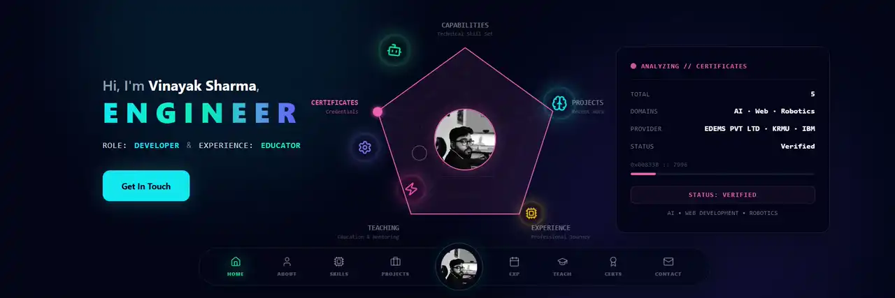

<div align="center">
  
  <br><br>

# Hi there, I'm Vinayak Sharma 👋
### AI/ML Research Engineer • Physical AI & Robotics Builder • Systems Architect

[](https://vinayaksharmadev.vercel.app/)
[](https://vsbeginner-genai-study-tip.streamlit.app)
[](https://github.com/vsbeginner)
[](https://www.linkedin.com/in/vinayak-sharma-24a8aa384/)
[](mailto:vsbeginner14@gmail.com)
[](https://github.com/vsbeginner)

<p align="center">
  
</p>

</div>

---

## 👨‍💻 Executive Profile

I am an **AI/ML Research Engineer and Robotics Builder** pursuing a **Master of Computer Applications (MCA) with specialization in AI & Machine Learning** at **K.R. Mangalam University**, and a Core Contributor at **EDEMS Pvt. Ltd.**

My engineering work bridges the gap between theoretical deep learning foundations and real-world physical and digital systems:
- **Generative AI & Probabilistic Modeling**: Evidence Lower Bound (ELBO) optimization in VAEs, adversarial game-theoretic minimax convergence in GANs, parameter-efficient fine-tuning (PEFT) on causal language models (GPT-2), and multimodal latent diffusion pipelines (Stable Diffusion v1.5).
- **Computer Vision & Physical Robotics**: Real-time object detection (YOLOv8, OpenCV), 2D Cartesian inverse kinematics, multi-axis motor actuation, and embedded microcontroller firmware (Arduino Mega, ESP32-S3).
- **Deep Neural Architectures**: Empirical implementations of MLPs, Deep CNNs, Bidirectional LSTMs, and sequence-to-sequence models with rigorous loss surface profiling.
- **Full-Stack AI Engineering**: High-performance responsive web applications, API microservices, and interactive data visualization dashboards (Next.js, FastAPI, Flask, Streamlit, Tailwind CSS).

---

## 🌟 Personal Portfolio

<div align="center">
  <a href="https://github.com/vsbeginner/Vinayak-Sharma-Personal-Portfolio-Website">
    
  </a>
  <br><br>
</div>

Modern, responsive engineering portfolio and interactive platform showcasing AI/ML research projects, robotics perception systems, and full-stack software architectures:

- **Dynamic Interactive UX**: Seamless fluid animations, dynamic typography, and responsive component hierarchy optimized across mobile and desktop displays.
- **Engineering Visualizations**: Multi-dimensional skill telemetry, interactive technical matrices, and real-time project metrics.
- **Production Architecture**: Zero-dependency optimized frontend deployed on Vercel's global edge network with sub-second paint times and automated asset pipeline optimization.

---

## 🛠️ Comprehensive Technical Architecture & Skill Matrix

```
                                  Technical Specializations
                                              │
         ┌───────────────────┬────────────────┼───────────────────┬───────────────────┐
         │                   │                │                   │                   │
   Generative AI        Deep Learning    Computer Vision     Full-Stack Systems    Embedded &
      & LLMs             Frameworks        & Robotics           Engineering         Hardware
         │                   │                │                   │                   │
   • Transformers      • PyTorch        • OpenCV            • Next.js / React   • Arduino Mega
   • Diffusers (SD)    • TensorFlow     • YOLOv8 / YOLOv11  • FastAPI / Flask   • ESP32-S3
   • PEFT / LoRA       • Keras          • Object Tracking   • TypeScript        • L298N Drivers
   • Causal Decoding   • NumPy / SciPy  • Inverse Kinematics• Streamlit / CSS3  • Sensor Fusion
   • VAEs / GANs       • Scikit-Learn   • Spatial Transform • Tailwind CSS      • Motor Actuation
```

---

## 📊 Live GitHub Telemetry & Statistics

<div align="center">
  <table border="0">
    <tr>
      <td>
        
      </td>
      <td>
        
      </td>
    </tr>
  </table>

  <br>

  
</div>

---

<div align="center">
  <sub>Crafted with engineering precision. Explore my live interactive portfolio at <a href="https://vinayaksharmadev.vercel.app/"><strong>vinayaksharmadev.vercel.app</strong></a>.</sub>
</div>
